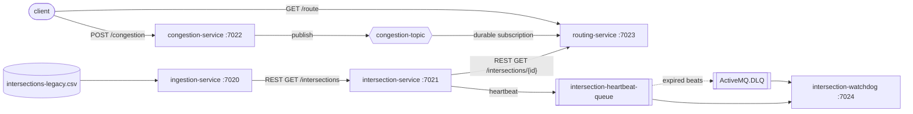

# TrafficFlow

WTC-96X5NUKQ

## Overview

Urban traffic light control and congestion-based routing.

Domain entities: intersections, districts, signal types.

Every class in this repo lives in a single flat package, `co.wethinkcode.trafficflow`. TrafficFlow is built
as a small set of independent services, following a growth path from simple data
cleanup through synchronous REST calls to asynchronous MQ decoupling and alerting:

1. clean a messy legacy CSV export (`intersections-legacy.csv`) — handled by **IngestionServiceApp**
2. serve it up and act on it, via three REST services calling each other directly
   over HTTP
3. decouple the relevant services with an ActiveMQ topic (`congestion-topic`) instead of
   direct calls — shared broker setup lives in [`common/`](common)
4. raise the alarm on failure — handled by **IntersectionWatchdogApp**

| Service | Folder | Port | Role |
|---|---|---|---|
| IngestionServiceApp | [`ingestion-service/`](ingestion-service) | 7020 | Parses and cleans `intersections-legacy.csv` |
| IntersectionServiceApp | [`intersection-service/`](intersection-service) | 7021 | Validates intersection/district names (source of truth). |
| CongestionServiceApp | [`congestion-service/`](congestion-service) | 7022 | Tracks the city-wide Congestion Level (0-8). |
| RoutingServiceApp | [`routing-service/`](routing-service) | 7023 | Provides estimated travel times based on congestion and intersection. |
| IntersectionWatchdogApp | [`intersection-watchdog/`](intersection-watchdog) | 7024 | cries for help if the Intersection Service crashes, since routes can no longer be validated. |

Plus [`common/`](common) (no port) — the shared ActiveMQ broker and MQ config notes
for `congestion-topic`: Routing Service becomes aware of congestion changes via an ActiveMQ Topic instead of querying Congestion Service directly.

**Status:** all four stages are implemented and covered by 58 automated tests
(`mvn test` in each module). See [What is implemented](#what-is-implemented).

## Your task

Build out the four stages below, roughly in order — each stage builds on the last.
Stages 1-2 are the core exercise; stages 3-4 are stretch goals if you have time left.
Exact field names and response shapes are your call throughout — see
"Integration contracts" below for illustrative shapes, not a spec to match exactly.

| Stage | What | Required? | Rough effort |
|---|---|---|---|
| 1 | Clean `intersections-legacy.csv` in **IngestionServiceApp** and expose the cleaned records (see [`ingestion-service/README.md`](ingestion-service) for the specific data issues to handle) | Required | 1-2 hrs |
| 2 | Implement the domain endpoints in **IntersectionServiceApp**, **CongestionServiceApp**, and **RoutingServiceApp**, wired together with direct synchronous REST calls | Required | 2-3 hrs |
| 3 | Decouple Congestion → Routing with the `congestion-topic` ActiveMQ topic instead of a direct REST call (see [`common/README.md`](common)) | Stretch | 1 hr |
| 4 | Add heartbeat/dead-letter alerting in **IntersectionWatchdogApp** so it notices when the Intersection Service goes down | Stretch | 1 hr |

(Effort is a rough guide, not a hard budget — go with what feels right for your pace.)

## Integration contracts

Every place one service calls or messages another, with an illustrative shape.
None of these field names are binding — match the intent, not the exact JSON.

| From → To | Stage | Mechanism | Shape |
|---|---|---|---|
| ingestion-service → intersection-service | 1 | REST, `GET` | `GET /intersections` on ingestion-service (port 7020) → `200 OK` + JSON array of cleaned records, e.g. `[{"id": "INT-1001", "district": "Downtown", "signalType": "4-way", "active": true}, ...]`. intersection-service loads this as its canonical list. |
| routing-service → intersection-service | 2 | REST, `GET` | `GET /intersections/{id}` on intersection-service (port 7021) → `200 OK` with the record, or `404` if the id/district isn't recognized. routing-service calls this to validate a route's endpoints before estimating travel time. |
| routing-service → congestion-service | 2 | REST, `GET` | `GET /congestion` on congestion-service (port 7022) → `200 OK` + `{"level": 0-8}`. routing-service polls this per-request in stage 2. |
| congestion-service → routing-service | 3 | ActiveMQ Topic `congestion-topic` | Once stage 3 is in place, congestion-service publishes `{"level": 0-8}` to `congestion-topic` whenever the level changes, and routing-service subscribes instead of polling `GET /congestion`. Broker URL + topic name come from the shared `MqConfig` class — see [`common/README.md`](common). |
| intersection-service → intersection-watchdog | 4 | ActiveMQ Queue `intersection-heartbeat-queue` | intersection-service publishes a periodic heartbeat message to `intersection-heartbeat-queue`; intersection-watchdog consumes it and raises an alert (e.g. logs, or its own `/alert` state) if a heartbeat is missed or lands in the dead-letter queue. Queue name comes from the shared `MqConfig` class, same pattern as `congestion-topic` — see [`intersection-watchdog/README.md`](intersection-watchdog). |

## What is implemented

| Stage | Where | What it does |
|---|---|---|
| 1. Clean the CSV | `ingestion-service` | Trims/collapses whitespace, fixes casing, lower-cases signal types, normalises Y/yes/1/TRUE flags, turns `unknown`/blank into `null`, merges duplicate IDs (`INT-1005` / `int-1005`). 18 raw rows become 17 intersections. |
| 2. REST services | `intersection-service`, `congestion-service`, `routing-service` | intersection-service loads the cleaned data over REST and validates names; congestion-service stores the 0-8 city-wide level; routing-service estimates travel time. |
| 3. MQ topic | `congestion-service` -> `congestion-topic` -> `routing-service` | Level changes are published to the topic; routing-service holds a **durable** subscription and answers from its own cache instead of polling. |
| 4. Watchdog | `intersection-service` -> `intersection-heartbeat-queue` -> `intersection-watchdog` | intersection-service sends a heartbeat every few seconds; the watchdog raises an alert when beats stop (or land in the dead-letter queue) and a recovery notice when they return. |



## API reference

| Service | Endpoint | Result |
|---|---|---|
| ingestion-service | `GET /intersections`, `GET /intersections/{id}`, `GET /report` | cleaned records, one record (`404` if unknown), what the cleaning run did |
| intersection-service | `GET /intersections[?district=X]`, `GET /intersections/{id}` | records; `404` if the id is not recognised |
| | `GET /districts`, `GET /districts/{name}` | district names; `404` for an unknown district |
| | `GET /heartbeat`, `POST /refresh` | heartbeat status; reload from ingestion |
| congestion-service | `GET /congestion` | `{"level": 3}` |
| | `POST /congestion` body `{"level":4}` | updates the level, publishes on change; `400` for a bad body or a level outside 0-8 |
| routing-service | `GET /route?from=INT-1001&to=INT-1005` | `200` estimate with breakdown, `400` bad input, `404` unknown, `409` inactive, `502` intersection-service down |
| | `GET /congestion` | the level the MQ subscription has learned |
| intersection-watchdog | `GET /alert` | state (`UNKNOWN`/`UP`/`DOWN`), last heartbeat, seconds of silence, alert history |

## Configuration

| Variable | Service | Default |
|---|---|---|
| `INGESTION_URL` | intersection-service | `http://localhost:7020` |
| `INTERSECTION_URL` | routing-service | `http://localhost:7021` |
| `HEARTBEAT_INTERVAL_SECONDS` | intersection-service **and** intersection-watchdog (keep equal) | `5` |
| `MAX_MISSED_BEATS` | intersection-watchdog | `3` |

The broker URL, topic and queue names live in each service's `mq/MqConfig.java`.

## Design decisions

- **Duplicates** share an ID once casing is fixed, so they are merged field by field: most common non-null value,
  `active` by majority, a tie fails safe to `false`, all-unknown stays `null`. Missing values stay explicit
  `null`s so downstream services can see they are missing.
- **REST vs MQ**: intersection data is read on demand and rarely changes (REST). The congestion level changes at
  unpredictable moments and routing should not poll for it (topic).
- **Topic for congestion, queue for heartbeats**: many services may care about congestion (publish/subscribe);
  a heartbeat has exactly one reader, the watchdog (point-to-point). Heartbeats are non-persistent with a
  time-to-live; expired beats go to the dead-letter queue (ActiveMQ checks for expiry every 30 s by default).
- **Durable subscription** for routing-service so a restart does not lose congestion updates.
- **Limitation**: until the first message arrives, routing-service assumes congestion level 0.

## Demo

With the broker and all five services running: `./scripts/demo.sh`

## Project structure

```
trafficflow/
├── README.md
├── .gitignore
├── ingestion-service/          (port 7020)
│   ├── pom.xml
│   ├── README.md
│   └── src/main/
│       ├── java/co/wethinkcode/trafficflow/IngestionServiceApp.java
│       └── resources/intersections-legacy.csv
├── intersection-service/          (port 7021)
├── congestion-service/          (port 7022)
├── routing-service/          (port 7023)
├── common/
│   ├── docker-compose.yml
│   └── README.md
└── intersection-watchdog/          (port 7024)
```

## Build

Requirements: Java 17+, Maven 3.8+, Docker (for the broker in `common/`).

Every folder here (`ingestion-service/`, each domain service, and `intersection-watchdog/`) is
an **independent** Maven project — there is no parent/aggregator pom. Build one at a
time, e.g.:

```
cd intersection-service
mvn package
```

...or build every module in the repo in one pass from the project root:

```
find . -name pom.xml -execdir mvn -q package \;
```

## Run

```
# ingestion
cd ingestion-service && mvn package && java -jar target/ingestion-service.jar

# domain services, each in its own terminal
# terminal 1
cd intersection-service && mvn package && java -jar target/intersection-service.jar
# terminal 2
cd congestion-service && mvn package && java -jar target/congestion-service.jar
# terminal 3
cd routing-service && mvn package && java -jar target/routing-service.jar

# MQ broker (needed once the MQ-aware services above are wired up)
cd common && docker compose up -d

# alerting
cd intersection-watchdog && mvn package && java -jar target/intersection-watchdog.jar
```

| Service | Port |
|---|---|
| IngestionServiceApp (`ingestion-service`) | 7020 |
| IntersectionServiceApp (`intersection-service`) | 7021 |
| CongestionServiceApp (`congestion-service`) | 7022 |
| RoutingServiceApp (`routing-service`) | 7023 |
| IntersectionWatchdogApp (`intersection-watchdog`) | 7024 |

## Test

Every module has JUnit 5 tests (`mvn test` inside the module; 58 in total). The MQ tests use an embedded
in-JVM ActiveMQ broker, so Docker is not needed to run them. Each running service also exposes
`/health`, so you can sanity-check manually:

```
curl http://localhost:7020/health   # -> OK
```
